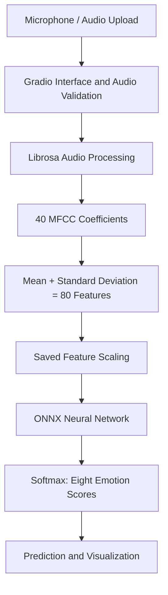

#  Speech Emotion Recognition — PyTorch & ONNX Runtime
It's an end-to-end machine learning application that categorizes the vocal expression into 8 emotion categories using audio feature extraction, training of a neural network with PyTorch and ONNX Runtime for lightweight inference.

**[Try the Live Demo](https://speech-emotion-recognition-pytorch.onrender.com)** · **[ Architecture Diagram](docs/architecture.md)**


## Overview

This project is a walk through of building and deploying an audio classification system, starting fromfeature engineering, training a neural network, optimizing the inferences and creating an interactive web interface.

Users can record their voice using the microphone, or upload an audio file. The application extracts acoustic features and predicts an emotion along with scores for eight emotion classes.

Model was trained on the RAVDESS acted-speech data set. It is a trial and trial only, and cannot be used as a gauge of the real emotional condition of any particular individual.

## Features

- Record audio and upload files using a microphone via Gradio.
- The classification of the eight classes of speech emotion.
- The features used are extracted using 80 MFCC features. 
- Neural network trained with PyTorch
- Infers without the need of PyTorch in production.  
- Ensure that the audio length and file size are correct.
- Check the length of the audio files and filesize. 
- Visualization of scores and progress feedback based on emotions.  
- Automated unit tests
- Deployment on Render

## Technology Stack

| Category | Technologies |
|---|---|
| Language | Python |
| Model training | PyTorch |
| Production inference | ONNX Runtime |
| Audio processing | Librosa, SoundFile, NumPy |
| Machine learning | scikit-learn |
| Web interface | Gradio |
| Hosting | Render |
| Version control | Git, GitHub |

## System Architecture



For component responsibilities and deployment architecture, see the **[architecture documentation](docs/architecture.md)**.

## Model Architecture

The fully connected neural network has the following structure:

| Layer | Configuration |
|---|---|
| Input | 80 MFCC-derived features |
| Hidden layer 1 | 64 neurons, ReLU |
| Hidden layer 2 | 32 neurons, ReLU |
| Output | 8 emotion classes |

The labels that are there are neutral, calm, happy, sad, angry, fearful, disgusted, and surprised. Themodel takes in standardised features. ONNX Runtime produces logits during inference and then appliessoftmax to compute class scores.

## Evaluation

**Held-out speaker test accuracy: 39.58%.**

This was obtained by taking speakers out of the RAVDESS acted-speech database.

The evaluation shows how challenging is the generalisation of speech emotion classification across speakers. A high rating on one of the predictions is not proof of the emotion being right.

The application is designed to be a machine learning engineering demonstration, and not a psychological assessment or production emotion-detection system.

## Optimizing Deployment Memory

PyTorch was used for the original application for training and inference. The application restarted due to memory on Render's free instance.

The trained network was exported to ONNX and connected with ONNX Runtime to decrease the runtime memory requirement.

The conversion was benchmarked with PyTorch with the same model inputs.

**Local measurements:**

| Measurement | PyTorch | ONNX Runtime |
|---|---:|---:|
| Process memory after model loading | 205.5 MB | 52.2 MB |
| Process memory after sample prediction | 319.5 MB | 181.1 MB |

These are not peak memory measurements, but are measurements of Mac OS processes. They are not guaranteed to have the same impact on the Linux deployment.

The difference between the logits of the numerical conversion test was approximately 7.15e-7; all of the test inputs had matching predicted classes.

## Run Locally

Clone the repository:

```bash
git clone https://github.com/lil8trap/speech-emotion-recognition-pytorch.git
cd speech-emotion-recognition-pytorch
```

Create a virtual environment:

```bash
python3 -m venv .venv
source .venv/bin/activate
```

Install the lightweight inference dependencies:

```bash
python -m pip install -r requirements-render.txt
```

Launch the web application:

```bash
python app.py
```

Open `http://127.0.0.1:7860` in your browser.

For model development, use the dependencies in `requirements.txt`, which include PyTorch.

## Testing

Run the automated tests using the full development environment:

```bash
python -m unittest discover -s tests -v
```

The existing suite includes seven tests covering feature extraction, checkpoint loading, classifier outputs, emotion labels, and end-to-end inference.

## Project Structure

```text
speech-emotion-recognition-pytorch/
├── app.py
├── src/
│   ├── features.py
│   ├── model.py
│   ├── predict.py
│   ├── predict_onnx.py
│   ├── train.py
│   ├── evaluate.py
│   └── prepare_data.py
├── models/
│   ├── emotion_classifier.onnx
│   ├── emotion_classifier.onnx.data
│   ├── emotion_scaler.npz
│   └── emotion_nn_80_weighted_checkpoint.pt
├── docs/
│   └── architecture.md
├── tests/
│   └── test_pipeline.py
├── export_onnx.py
├── compare_onnx.py
├── requirements.txt
└── requirements-render.txt
```

## Deployment

The application is deployed as a Python web service on Render.

Build command:

```bash
pip install -r requirements-render.txt
```

Start command:

```bash
python app.py
```
The application uses the value of the environment variable PORT set by Render to read the server port.

The startup warmup is not mandatory and will be disabled by default if the parameter ENABLE_WARMUP=0.

The delays after inactivity can be caused by free hosting.

## Limitations and Future Improvements

- Add more training data and experiment with models to enhance speaker-independent generalization
- Test out the performance in various accents, mics and recording environments
- Enhance the skill of prediction calibration and communication of confidence.
- Scale up automated testing of ONNX deployment path.
- Continue to track memory usage/cold start behavior

## Author

Developed as a personal machine learning and software engineering portfolio project.

**GitHub:** [lil8trap](https://github.com/lil8trap)
