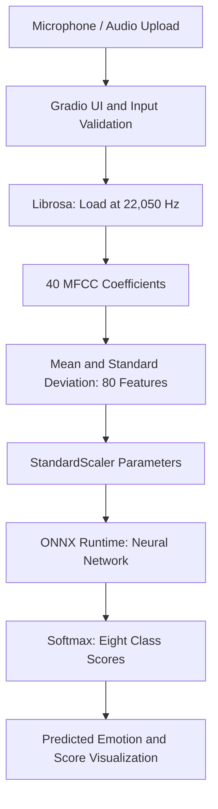

# Speech Emotion Recognition — Architecture

## Overview

This application classifies vocal expressions using an
80-feature speech representation and a neural network
exported from PyTorch to ONNX.

## Inference Pipeline

## Main Components

| Component | Responsibility |
|---|---|
| `app.py` | Gradio interface, validation and error handling |
| `src/features.py` | Extracts 80 MFCC-derived features |
| `src/predict_onnx.py` | Feature scaling and ONNX inference |
| `models/emotion_classifier.onnx` | Exported neural network |
| `models/emotion_classifier.onnx.data` | External ONNX parameters |
| `models/emotion_scaler.npz` | Saved scaling parameters |
| `src/train.py` | PyTorch model training |
| `src/evaluate.py` | Evaluation of the trained classifier |

## Deployment

The inference application runs on Render using
`requirements-render.txt`, with ONNX Runtime instead
of PyTorch. The free service may experience cold starts.

## Limitations

The classifier was evaluated on held-out speakers from
the RAVDESS acted-speech dataset and achieved 39.58%
accuracy. Predictions are experimental and should not
be interpreted as reliable measurements of actual emotions.

